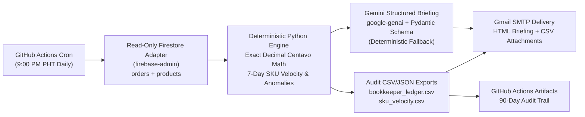

# ely-ops-automator

Scheduled, read-only **daily bookkeeping reconciliation, anomaly audit, and AI wholesale restock briefing** pipeline built for **ely.pos** (*Ely's Fresh Fruits & Veggies*).

## Problem It Replaced

Running a counter POS makes daytime checkout fast, but closing out the store each night was still manual and error-prone:
1. Pulling daily orders and separating walk-in vs. neighborhood delivery sales across subdivision phases.
2. Cleaning floating-point precision artifacts from historical JS totals into an exact centavo bookkeeper ledger.
3. Catching unclosed `Pending` delivery tickets and unusual bulk orders before closing.
4. Estimating tomorrow's 4:00 AM wholesale produce buying list from memory instead of 7-day SKU velocity.

## Architecture



### Core Engineering Decisions
- **Strictly Read-Only on Production POS:** Connects to `freshbyely` Cloud Firestore using `firebase-admin` with zero `.set()`, `.update()`, or `.delete()` operations. Live counter operations are never touched.
- **Deterministic Financial Math, AI Synthesis Only:** All centavo rounding, order reconciliation, variance detection, and 7-day velocity ratios run in pure Python (`decimal.Decimal`). Gemini (`gemini-3.8-flash` via `google-genai`) only receives verified numeric summaries under a strict Pydantic schema (`OpsBriefing`) to generate the owner's produce-buying briefing.
- **Resilient Fallback:** If `GEMINI_API_KEY` is absent or rate-limited, a deterministic rule-based briefing engine runs automatically so the daily ledger and email never fail silently.
- **Zero-Cost Cloud Hosting:** Runs on GitHub Actions (`cron: "0 13 * * *"` = 9:00 PM PHT) + Gmail SMTP + Gemini free tier (~250–350 Firestore reads/day).

## Stack

- **Language:** Python 3.13
- **Database SDK:** `firebase-admin` (read-only Firestore queries)
- **AI / Validation:** `google-genai` (`gemini-3.8-flash`) + `pydantic` v2
- **Scheduling & Archival:** GitHub Actions (`schedule` + `workflow_dispatch` + 90-day artifacts)
- **Delivery:** `smtplib` (Gmail STARTTLS) with responsive HTML + plaintext + CSV attachments
- **Testing:** `pytest`

## Quick Start

```bash
python -m venv .venv
# Windows PowerShell:
.venv\Scripts\Activate.ps1
pip install -e ".[dev]"
pytest -v
```

### Run Offline Dry-Run (Against a Local POS CSV Export)

```bash
cp .env.example .env
python -m ely_ops.main \
  --source csv \
  --csv-orders path/to/orders_rows.csv \
  --products-json path/to/backup_products.json \
  --date 2026-05-06 \
  --dry-run
```

### Run Against Live Firestore (Read-Only)

Configure `FIREBASE_SERVICE_ACCOUNT_PATH` (or `FIREBASE_SERVICE_ACCOUNT_B64`), `GEMINI_API_KEY`, and Gmail SMTP variables in `.env`, then run:

```bash
# Preview outputs locally without sending email
python -m ely_ops.main --source firestore --dry-run

# Run full production pipeline + send email
python -m ely_ops.main --source firestore
```

## GitHub Actions Deployment (Secrets)

Add the following **Repository Secrets** in GitHub (`Settings -> Secrets and variables -> Actions`):

| Secret | Purpose |
| --- | --- |
| `FIREBASE_SERVICE_ACCOUNT_B64` | Base64-encoded Firebase Admin SDK service account JSON |
| `GEMINI_API_KEY` | Google AI Studio API key for `gemini-3.8-flash` |
| `SMTP_USER` | Sender Gmail address |
| `SMTP_APP_PASSWORD` | 16-character Google App Password |
| `REPORT_RECIPIENT_EMAIL` | Owner / bookkeeper destination email |

No credentials are ever committed to the repository.
